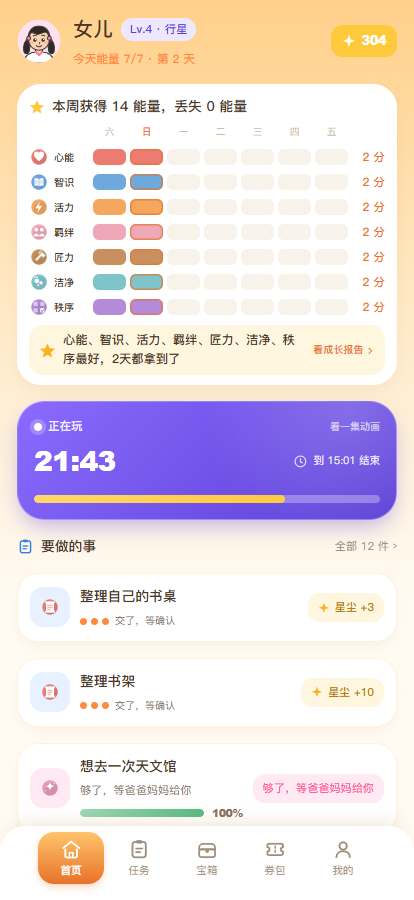
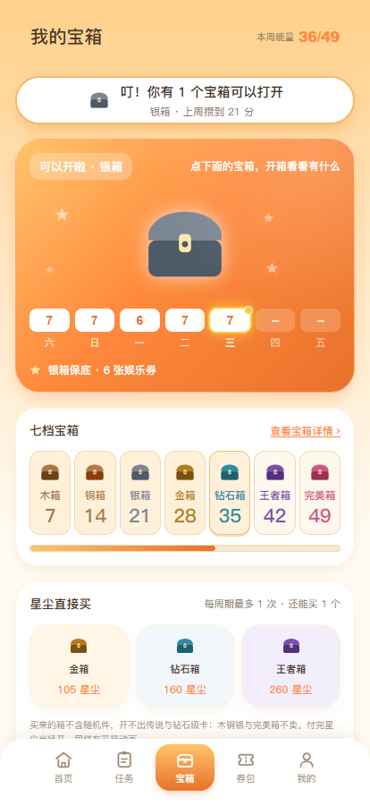
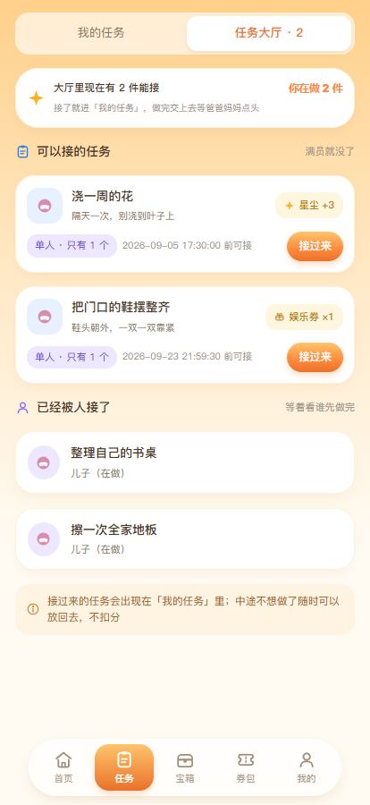
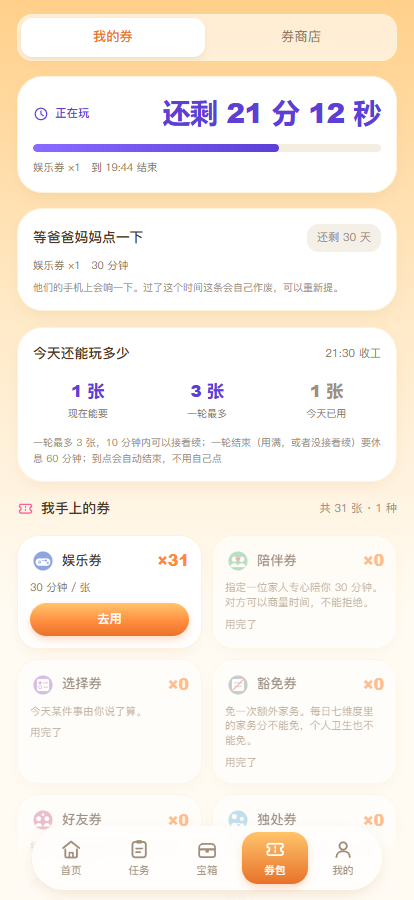
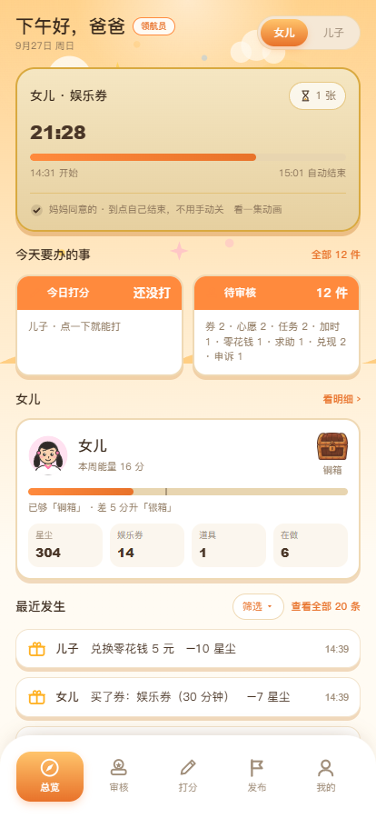
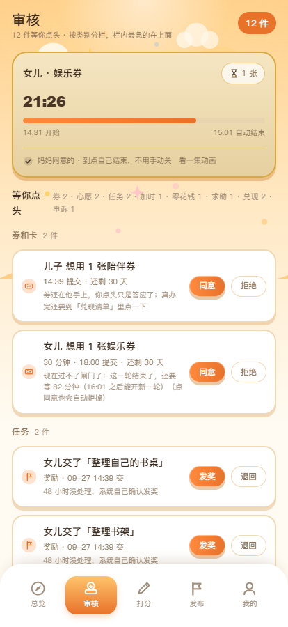
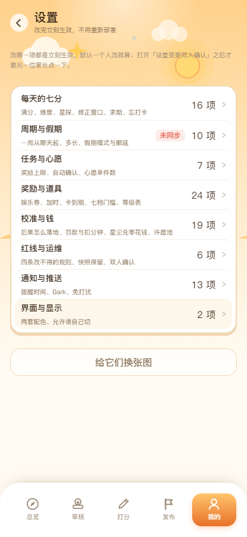

<p align="center">
  
</p>

<h1 align="center">家庭积分 FamilyPoints</h1>

<p align="center">
  七个维度 · 每日打分 · 宝箱与星尘 · 任务与心愿 · 券与零花钱
</p>

<p align="center">
  
  
  
  
  
</p>

---

自建的家庭积分系统，跑在自己家的 NAS 上。孩子每天七个维度各 1 分，攒周能量开宝箱，攒星尘换消费额度、娱乐时间和特权券。四个家人各有自己的界面：孩子端只看得见自己的分和手上的活，家长端只做裁判。

Python 3 标准库 + SQLite，没有第三方依赖，不用 `pip install`，一个 Docker 容器装完。手机浏览器打开就能用，桌面宽屏自动排成两列三列。

## 功能

**孩子端**

- **七维矩阵**：心能、智识、活力、羁绊、匠力、秩序、洁净，一周七天横着铺开。抬头写「本周获得 X 能量，丢失 N 能量」，底下两句是现算的结论。
- **任务**：大厅接活、我的任务分「在做 / 等确认」，心愿和校准卡按走到哪一步落进这两栏，任务记录最多回溯近一个月。
- **宝箱七档**：门槛 7 / 14 / 21 / 28 / 35 / 42 / 49 分，达标能开，也能花星尘直接买。箱子发下来先躺着，孩子自己点开才抽内容。
- **券包**：娱乐券、陪伴券、选择券、豁免券、好友券、独处券。娱乐券按「轮」算，白天 3 张、晚间 2 张，用完歇 60 分钟，到点自动结束。
- **成长页**：等级与升级进度、星尘余额、特权道具、完美日、心愿屋、成长报告、图鉴、怎么玩（把规矩讲给孩子听的四页）。

**家长端**

- **总览**：今天还没打分、待审核的件数，选中孩子这一周的实况，最近五条动态。
- **审核**：孩子交上来的活、券申请、心愿、加时、零花钱、求助、校准申诉，按类别和急事排；动账的动作先弹确认层。
- **打分**：四个人 × 七个维度，「还没打 / 可以补 / 已经打了 / 过期锁死」四态，默认全给满，点掉没做到的项。
- **发布**：写任务（挂大厅或派给某个孩子，可配图）、写校准（选处理方式和后果档位）、周期任务模板。
- **我的**：身份卡、家庭和账号、宝箱与道具、规则说明、心愿与许愿池、设置、备份与导出。
- **规则说明**：家长口径的规则全书，三页目录与细则，数字全部从当前设置现取。

**规则与运营**

- **周期任务**（v1.25）：每天 / 每周某天 / 每月 1–28 号，到点自动生成普通任务，每个模板单独一个事务，重启不会重发；停几天也不会补发一堆积压任务。
- **未打分提醒**（v1.22）：几点开始提醒、提醒几次、间隔多久，三项都能设；只提醒当天，不跨天补发。
- **推送**：Bark（iOS）与 ntfy（安卓/自建）。每条通知先落网页再推手机，推送掉线只会让手机安静，不会漏事；最近一次失败原因在设置页可见。
- **假期日历**：国家法定假日一键拉取，自家寒暑假手动填；假期里维度考核换成计划表执行和家务分担。
- **赛季**：按季结算欠账与道具，季末清账规则写在规则说明里。

**工程**

- **零依赖**：没有 npm、没有 pip、没有构建步骤，改一行前端刷一下就见效。
- **账号安全**：PBKDF2 加盐、HttpOnly Cookie、连续错密码限速 429、首次设置一次性安装码。
- **备份**：每天自动快照保留 30 天并只读校验；全量 JSON 导出；`verify_backup.py` / `restore_backup.py` / `reset_admin.py` 三个运维脚本随包发布。
- **首屏**：按角色加载资源，孩子端不下载家长端 CSS/JS；文本资源 gzip，JS/CSS 带版本号长缓存，`sw.js` 缓存 app shell 供二次打开。

## 界面截图

| 孩子端 · 首页 | 孩子端 · 宝箱 |
|:---:|:---:|
|  |  |

| 孩子端 · 任务大厅 | 孩子端 · 券包 |
|:---:|:---:|
|  |  |

| 家长端 · 总览 | 家长端 · 打分 |
|:---:|:---:|
|  |  |

| 家长端 · 审核 | 家长端 · 设置 |
|:---:|:---:|
|  |  |

登录是头像墙，点自己的头像再输四位数字。任务大厅、图鉴、成长报告、怎么玩、发布、家庭和账号、规则说明等其余截图都在 [`screenshots/`](screenshots/) 里。

## 安装

### 方式一：Docker（推荐）

```bash
git clone https://github.com/WW-Ares/FamilyPoints.git
cd FamilyPoints/app
docker compose up -d --build
```

打开 `http://<NAS 的地址>:3637`。数据落在 `app/data/`，整个目录拷走就是完整备份；换机器时连 `-wal` / `-shm` 一起拷，或者直接用 `data/snapshots/` 里的每日快照。

也可以用 [Releases](https://github.com/WW-Ares/FamilyPoints/releases) 里的压缩包，解压后 `cd family-points && docker compose up -d --build`。

### 方式二：源码直接跑

```bash
cd app
python server.py          # 需要 Python 3.11+，没有别的依赖
```

端口、反代、开机自启、排错写在 [app/部署到NAS.md](app/部署到NAS.md)。

### 第一次打开：设管理员

第一次进会到「首次设置」页，要填一次性安装码。安装码在容器日志里：

```bash
docker logs family-points 2>&1 | grep 安装码
```

想固定一个安装码，就在 `docker-compose.yml` 的 `environment` 里加一行 `FAMILY_SETUP_TOKEN: "你的安装码"`。

账号名填 `爸爸`，设一个密码。爸爸是管理员，能开通妈妈、女儿、儿子的账号、改密码、改名字。**密码没法找回**，管理员忘了只能停机用 `reset_admin.py` 改。

## 快速上手

### 第一天

1. 设完管理员，进「我的 → 家庭和账号」，给其余三个人开账号、设密码。
2. 进「设置」，按自家情况调七维权重、宝箱门槛、券价、娱乐券时长。
3. 进「发布」，挂几个任务到大厅，或者直接派给孩子；顺手建两条周期任务（倒垃圾、练琴）。
4. 进「设置 → 通知与推送」，填 Bark / ntfy 地址，点测试发送。

### 每天

- **家长**：打分页点掉没做到的项 → 审核页清待办 → 需要时发新任务或校准。
- **孩子**：任务页接活、交活 → 攒够能量开宝箱 → 用券，娱乐券按轮到点自动结束。

### 每周

- 总览看本周能量和升档进度；周期任务会自动出现在孩子的任务列表里。

## 数据与备份

每天一份快照，落在 `data/snapshots/`，保留 30 天，生成后自动只读校验；校验不过会在设置页亮出来。

```bash
# 校验最新快照（不传 --db 就找最新的）
cd app && python tools/verify_backup.py

# 和在线库比行数
FAMILY_DATA_DIR=/vol1/docker/family-points/data python3 tools/verify_backup.py --against-live

# 预演恢复（只读，不写库）
FAMILY_DATA_DIR=/vol1/docker/family-points/data python3 tools/restore_backup.py --db data/snapshots/family-2026-11-17.db

# 真恢复：先自动给当前库打快照，再原子替换
FAMILY_DATA_DIR=/vol1/docker/family-points/data python3 tools/restore_backup.py --db data/snapshots/family-2026-11-17.db --apply --yes --allow-live

# 管理员密码重置
FAMILY_DATA_DIR=/vol1/docker/family-points/data python3 tools/reset_admin.py --list
```

网页端「我的 → 备份与导出」能导出全量 JSON（不含会话和登录记录），也能一键校验最近一份快照；恢复只走命令行，避免网页上误点。

## 规则都在库里

积分门槛、宝箱七档、券的价格和限购、娱乐券时长、硬停止时间、月兑换上限、星尘汇率、未打分提醒的时间与次数——没有一个是写死在代码里的。设置页里能改的都能改，改完立刻生效，不用重新部署。

## 目录

```text
app/                服务本体：后端、前端、测试、工具
  server.py         入口，http.server
  db.py             建库与迁移链（schema 49）
  engine.py         规则引擎，分数、宝箱、券、结算都在这
  notify.py         通知与定时任务（未打分提醒、周期任务、快照校验）
  api/              按域拆的接口
  web/              原生 JS + CSS，孩子端与家长端两套皮一份代码
  tools/            图标生成、打包、备份校验、端到端巡检
  smoke_test.py     引擎层测试
  api_test.py       接口层测试
docs/               规则真值与响应式方案
screenshots/        界面截图
```

## 测试

```bash
python app/tools/check_all.py      # 九项自检：语法、未定义标识符、事务、导出恢复、周期任务、冒烟、接口、文档
python app/smoke_test.py           # 引擎层
python app/api_test.py             # 接口层

# 端到端（打 8090 演示库，不要指向 8080 正式库）
FAMILY_BASE=http://127.0.0.1:8090 node app/tools/e2e_v13.js
```

## 技术选择

- **零依赖**：目标是长辈家里那台 NAS，装得上就永远跑得起来。没有 npm、没有 pip、没有构建步骤。
- **SQLite 单文件**：四个人用，并发压力约等于零。余额不做冗余字段，一律由流水求和，对不上账时能一行行查回去。
- **服务端渲染的不是页面，是数据**：前端是一份原生 JS，两套皮（`body.kid` / `body.grown`）共用同一份逻辑，改规则只用改一处。
- **规则会变，所以规则不进代码**：孩子会长大，家长的想法也会变，能调的都进设置表。

## 已知边界

- 推送只覆盖 Bark 和 ntfy；失败原因在设置页可见，但不会主动弹窗。
- 家长忘记密码没有邮箱找回，只能停机跑 `reset_admin.py`。
- 日志只增不改不删。
- 图标和头像不开放上传，换图要重新生成资源。
- 周期任务只支持星尘和周能量奖励，不支持券和零花钱（那两类要走审批）。

这些是取舍，不是没做完；每一条在代码注释和文档里都写着。

## 版本与文档

- 当前版本 **v1.25**，库结构 **schema 49**；更新内容看 [Releases](https://github.com/WW-Ares/FamilyPoints/releases)。
- 规则真值是 [`docs/项目当前开发文档.md`](docs/项目当前开发文档.md)，每一条都标了落在哪个文件哪一行。改代码前先看它，改完回头核对行号。
- 技术实现、为什么这么写、本地怎么跑测试，看 [app/README.md](app/README.md)。

## 贡献者

- [WW-Ares](https://github.com/WW-Ares)：产品设计、规则定义、实机测试与验收
- Codex：代码实现、测试与文档

## 许可

仓库公开，但不是开源。这里没有许可文件，未授予使用、复制、修改或再分发的权利。
